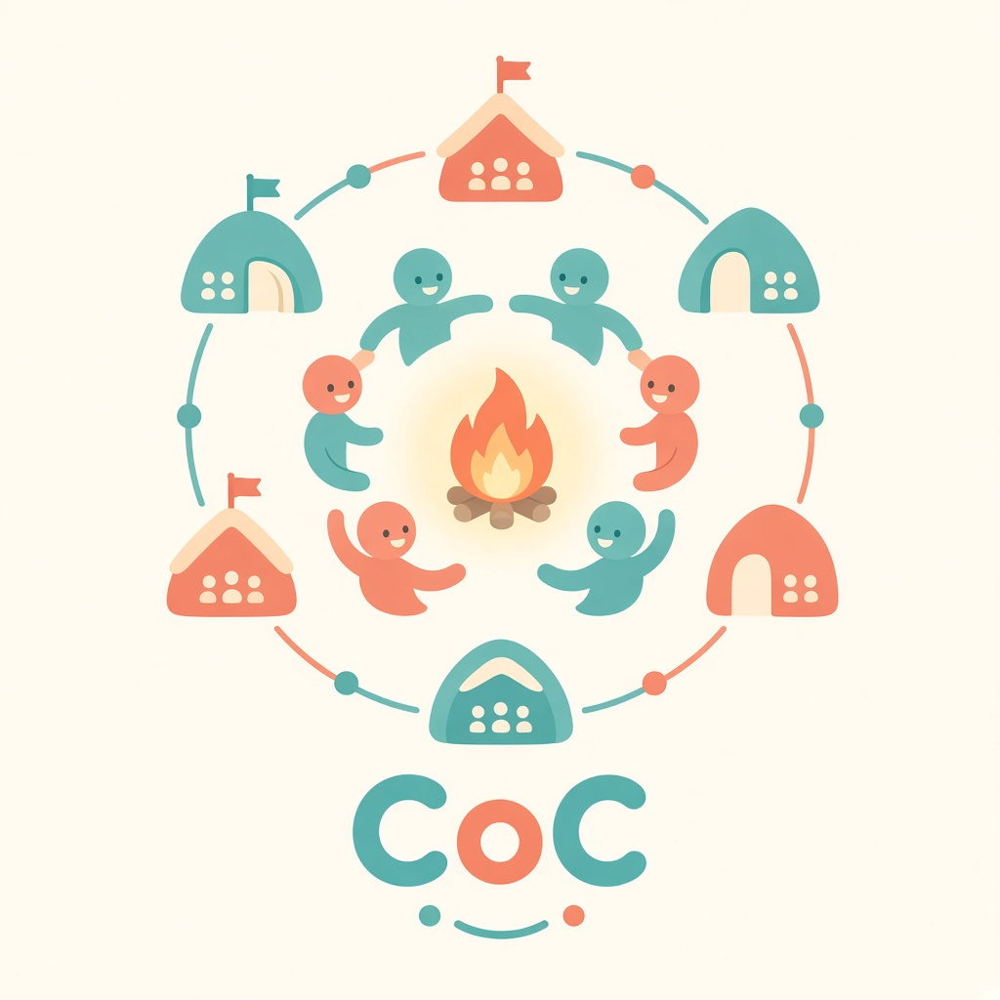

  <picture>
    <source srcset="assets/coc-logo.png" type="image/png">
    
  </picture>
  <h1>Community of Community</h1>
  
<strong>Make friends and Shared possibilities.</strong>

  
A public-benefit, non-commercial space connecting independent communities.

  

    
    
    
    
  

  
<strong>English</strong> · <a href="README.zh-CN.md">简体中文</a>

## What is CoC?

**Community of Community (CoC)** brings community founders, organizers, and builders together to make friends, exchange experience, and explore possibilities for shared benefit.

Each community has its own purpose, people, and strengths. We create common ground for those strengths to meet through shared learning, thoughtful introductions, and small collaborations. **We connect communities; we do not replace them.**

## Scope

- **Connect and learn:** exchange experience among community founders and organizers.
- **Share with consent:** introduce people and share knowledge or resources with permission.
- **Build together:** explore small joint initiatives, mutual support, and opportunities for young builders.

Communities remain independent and participation is voluntary. CoC does not run member communities, act as a commercial broker, or promise funding or reach.

## Founding Members

Our Founding Members help create this space for public-benefit collaboration. Each remains independent; cooperation starts with specific, mutually agreed initiatives.

- [ResearchBoost Agent (RBA)](https://ai4ai-for-anything.github.io/)
- [NextTransformer](https://interactive-active-ai.github.io/NextTransformer/)
- [LMMs-Lab](https://www.lmms-lab.com/)
- [Lumina Embodied](https://lumina-embodied.ai/)
- [OpenWAM](https://openwam-official.github.io/)
- [starVLA](https://github.com/starVLA/starVLA)

## Get involved

- **[Website](https://community-of-community.github.io/):** explore CoC and [introduce your community](https://community-of-community.github.io/#collaboration-form).
- **[Issues](https://github.com/Community-of-Community/CoC/issues):** introduce your community or propose a concrete collaboration using the templates.
- **[Discussions](https://github.com/Community-of-Community/CoC/discussions):** ask questions, exchange ideas, and find common interests.
- **[Contact](mailto:wayneyjin@gmail.com):** email us at wayneyjin@gmail.com; WeChat is available on request.

Issues and Discussions are public. Use email or the website form for personal contact details, and do not share confidential information. Respect each other's time, consent, attribution, and boundaries.
