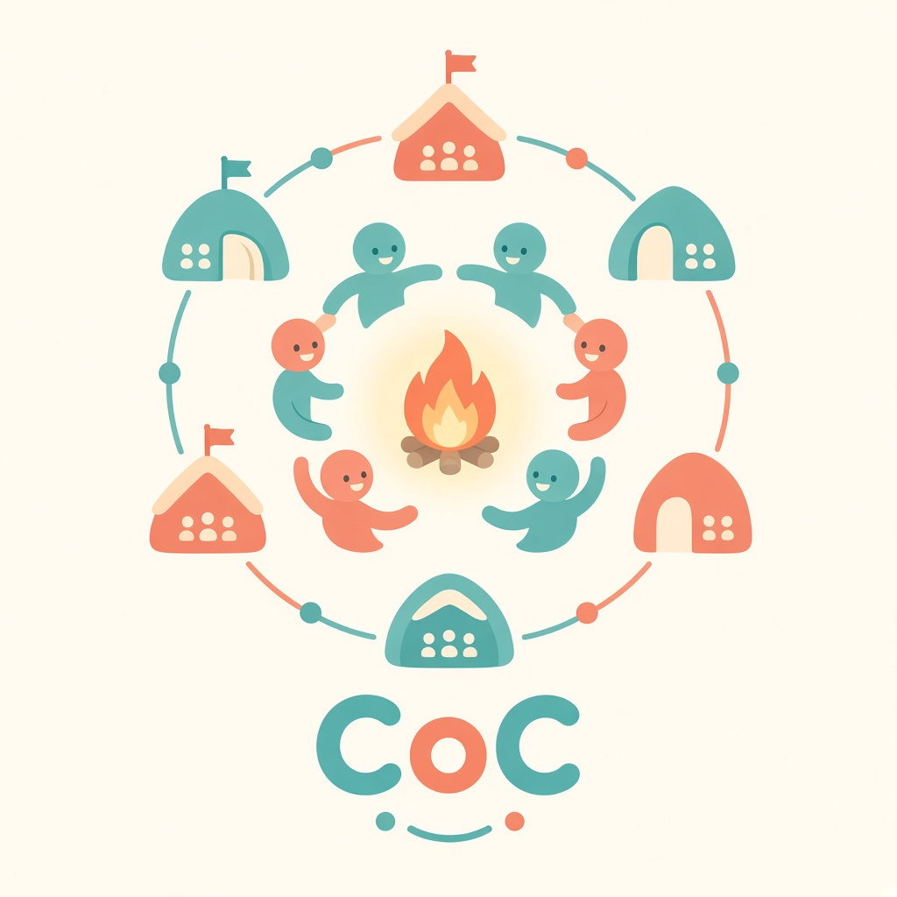

  <picture>
    <source srcset="assets/coc-logo.png" type="image/png">
    
  </picture>
  <h1>Community of Community</h1>
  
<strong>结交朋友，共享可能。</strong>

  
为交流创造空间，为合作建立连接。 从具体协作起步，共同积累经验。

  
由社区共同参与、服务社区的公益协作空间。

  

    <a href="https://github.com/WayneJin0918/Community-of-Community/issues">Issues</a> ·
    <a href="https://github.com/WayneJin0918/Community-of-Community/discussions">Discussions</a> ·
    <a href="mailto:wayneyjin@gmail.com">联系邮箱</a> ·
    <a href="https://waynejin0918.github.io/Community-of-Community/">主页</a>
  

  
<a href="README.md">English</a> · <strong>简体中文</strong>

## CoC 是什么？

**Community of Community（CoC）** 为社区创始人、组织者与建设者创造交流与合作空间，支持经验分享、资源连接以及有共同价值的协作。

各社区拥有自己的使命、成员与优势。CoC 希望减少重复探索，促进有意义的连接，并推动切实的相互支持。**我们连接社区，不替代各社区自身，也不从事商业中介服务。**

## 协作范围

| 参与范围（In scope） | 不参与范围（Out of scope） |
| --- | --- |
| 社区创始人与组织者交流、共同学习。 | 代管、整合成员社区，或代表成员社区发言。 |
| 经当事方同意的介绍、知识与资源分享。 | 商业撮合、付费获客，或出售成员联系渠道。 |
| 小规模共同项目、相互支持与年轻建设者的发展机会。 | 强制参与、承诺资金或传播效果，或未经许可分享非公开材料。 |

## 如何协作

目前处于**以信任关系为基础的起步阶段**：从相互介绍开始，欢迎新的视角，通过规模适当、切实有益的协作逐步建立信任。

1. **介绍正在开展的工作。** 说明社区或项目、能够提供的支持，以及希望寻求的合作。
2. **寻找共同关注点。** 探索合适的连接，不以参与为义务。
3. **明确一次具体协作。** 事先约定角色、时间投入、署名方式与可公开范围。
4. **共同复盘与分享。** 总结经验，在获得同意后分享有益成果。

## 未来目标

| 方向 | 希望促成的进展 |
| --- | --- |
| **促进创始人交流** | 支持初期社区创始人分享经验、获得反馈，并发现合作机会。 |
| **携手资深社区伙伴** | 邀请有经验的社区伙伴贡献知识，扩大有价值的公益协作的影响力。 |
| **支持年轻建设者** | 提供真实协作角色、经验指导与成果展示机会，帮助年轻建设者积累能力与作品。 |

这些是持续推进的方向，并非已经兑现的成果承诺。

## Founding Members（创始成员）

创始成员共同支持公益协作，为各社区创造连接与合作空间。各方保持独立，自愿参与，从具体且经共同确认的事项开始合作。

- [AI4AI for Anything](https://ai4ai-for-anything.github.io/)
- [NextTransformer](https://interactive-active-ai.github.io/NextTransformer/)
- [LMMs-Lab](https://www.lmms-lab.com/)
- [Lumina Embodied](https://lumina-embodied.ai/)
- [OpenWAM](https://openwam-official.github.io/)
- [starVLA](https://github.com/starVLA/starVLA)

## 参与 / 联系

- **[Issues](https://github.com/WayneJin0918/Community-of-Community/issues)：** 使用模板介绍社区，或提出具体合作建议。
- **[Discussions](https://github.com/WayneJin0918/Community-of-Community/discussions)：** 交流想法、提出问题，探讨共同关注的方向。
- **邮箱：** [wayneyjin@gmail.com](mailto:wayneyjin@gmail.com)。
- **[合作介绍表单](https://waynejin0918.github.io/Community-of-Community/#collaboration)：** 通过主页提交介绍；主页默认英文，可切换为中文。
- **微信：** 联系方式可按需提供；主页的 `WECHAT_ID` 在确认前保持为 `on request`。

GitHub Issues 与 Discussions 为公开内容。个人联系方式请通过邮箱或表单提供，请勿提交机密信息。

## 社区约定

CoC 是公益性质、非商业的协作空间。各社区保留独立性与决策权。尊重参与者的时间、意愿、署名与边界，不要求任何一方提供资源或参与合作。

**表单启用：** 合作介绍通过 FormSubmit 发送至 `wayneyjin@gmail.com`。首次使用时，请提交一条测试介绍，在该邮箱中打开 FormSubmit 的确认邮件并完成激活（同时检查垃圾邮件），再提交一次验证收件。请求被接受不等于邮件已经送达；如 AJAX 无法触发激活，可暂时禁用 JavaScript 后完成首次提交。无需注册账户或安装构建依赖。

开发者可选查看方式：[`scripts/preview.sh`](scripts/preview.sh)。
